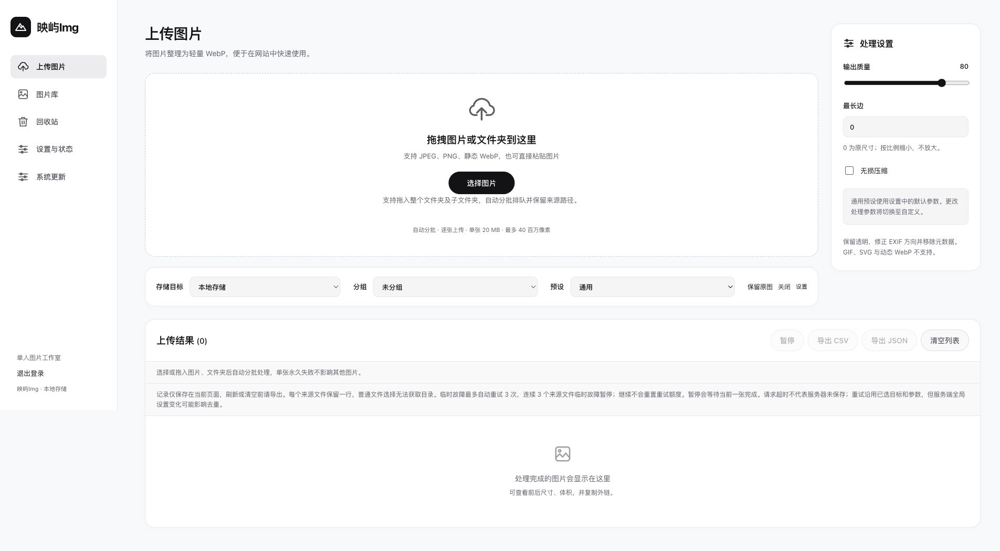
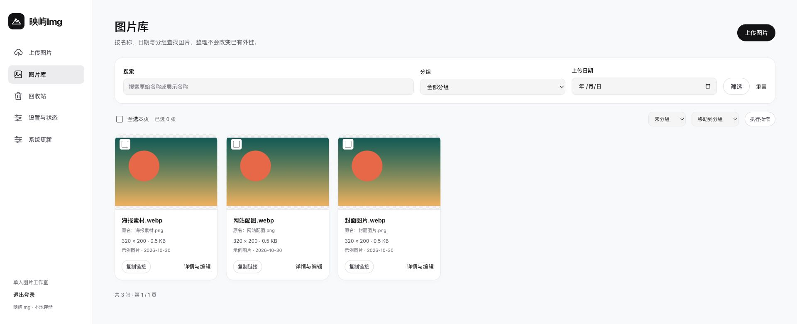
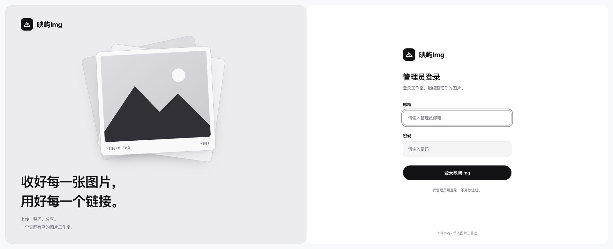

# 映屿 Img · Yingyu Img

面向个人的 WebP 图床，上传 JPEG、PNG 图片即可自动转换为 WebP，支持画质与尺寸调整。提供图片整理、外链分享和多存储管理。

**自动转换 WebP**：拖入图片或整个文件夹，自动分批转换与压缩，可调整画质和尺寸、导出上传记录。



**图片管理**：按名称、分组和日期查找图片，支持批量整理、复制外链与编辑图片信息。



**管理员登录**：独立的个人图片工作室，仅管理员可登录，不开放注册。



## 功能

- JPEG、PNG、静态 WebP 转公开 WebP，支持质量、无损、最长边、透明与 EXIF 方向修正；拒绝 GIF、SVG、APNG 和动态 WebP。
- 单管理员、禁止公开注册，支持登录限流、CSRF 防护与密码修改。
- 拖拽、粘贴、多图和文件夹上传，支持递归子目录、来源路径记录、CSV / JSON 导出。
- 超过每批上限时自动分批排队，单并发逐张处理，失败可重试；默认每批 50 张、单图 20 MB、4000 万像素。
- 本地、S3 兼容 / 腾讯云 COS、阿里云 OSS 存储配置；不同对象存储的权限、区域和自定义域名须按服务商要求配置。
- 图片分组、检索、名称 / alt 编辑、查重，支持直链、Markdown、HTML 复制与处理前后局部对比。
- 私有原图可选保留，回收站默认保留 30 天，支持停用、恢复与永久删除。
- 网页安装向导、环境诊断、只读文件审计、签名更新与受保护恢复入口。

前端使用 Blade、原生 JavaScript 和 CSS，无 Node 构建和外部 CDN；同步处理，不需要 Redis、Docker 或常驻队列。

## 运行环境

- PHP **8.4.1+**，Laravel **13.38.0**（版本由 `composer.lock` 锁定）。
- MySQL **8.0+**、Nginx，PHP CLI 与 FPM 使用一致的版本和扩展。
- Imagick / ImageMagick 具备 WebP 编解码能力。
- PHP 扩展：`ctype`、`curl`、`dom` / `xml`、`exif`、`fileinfo`、`filter`、`hash`、`iconv`、`imagick`、`json`、`mbstring`、`openssl`、`PDO`、`pdo_mysql`、`session`、`tokenizer`；依赖安装和更新解压还需 `zip` / `unzip`。

## 安装教程（Release 完整包）

### 1. 下载安装包

在 [Releases](https://github.com/luoyeai/yingyu-img/releases/latest) 下载 **`yingyu-img-1.0.0.zip`**。完整包已包含生产依赖，无需安装 Composer 或 Node。GitHub 自动生成的 `Source code` 是源码包，请选择上面的完整安装包。

### 2. 宝塔创建网站

1. 安装 Nginx、PHP **8.4.1+** 和 MySQL **8.0+**，为本站创建一个专用空数据库。
2. 添加网站并绑定域名，上传安装包，将 `image-vault/` 内的全部文件解压到网站目录。例如网站目录为 `/www/wwwroot/yingyu-img/`，其中应直接包含 `app/`、`public/` 和 `vendor/`。
3. 在“网站 → 设置 → 网站目录”中，将运行目录设为 **`/public`**；PHP 版本选择 **8.4**，配置域名证书并启用 HTTPS。
4. 安装并启用 Imagick（支持 WebP）、`pdo_mysql` 等所需扩展，确保 PHP CLI 与网站 PHP 的版本和扩展一致。其他缺项按安装页提示处理。

### 3. 设置伪静态

打开“网站 → 设置 → 伪静态”，粘贴以下完整内容并保存。保留宝塔默认 PHP 配置，不要将整份 Nginx `server` 配置粘贴到这里。

```nginx
# 粘贴到宝塔：网站 -> 设置 -> 伪静态（替换原伪静态，不要重复追加）。
# 前提：运行目录 /public；宝塔 PHP 版本选择 8.4，保留默认 enable-php-84.conf。
# server 级 return 防护先于任何 PHP/静态正则 location 生效，无需调整 include 顺序。
if ($uri ~* "^/(?:storage|originals|previews|disabled|vendor|app|bootstrap|config|database|resources|routes|tests|deploy|docs|bin)(?:/|$)") {
    return 404;
}
if ($uri ~ "(?:^|/)\.(?!well-known(?:/|$))") {
    return 404;
}
# 只允许 /index.php 进入宝塔现有 PHP handler，阻止其他脚本及 PATH_INFO。
if ($uri ~ "^/(?!index\.php$).*(?i:\.(?:php[0-9]*|phtml|phar))(?:[./]|$)") {
    return 404;
}
# 拒绝所有非规范 media 路径（包括大小写变形），避免被默认静态缓存正则接管。
if ($uri ~ "^(?!/media/[0-9]{4}/(?:0[1-9]|1[0-2])/[a-f0-9]{32}\.webp$)(?i:/media)(?:/|$)") {
    return 404;
}
location ^~ /media/ {
    try_files $uri =404;
    open_file_cache off;
    types { image/webp webp; }
    default_type image/webp;
    expires off;
    add_header Cache-Control "public, max-age=0, must-revalidate" always;
    add_header X-Content-Type-Options nosniff always;
    etag on;
}
location / {
    try_files $uri $uri/ /index.php?$query_string;
}
```

以上内容与包内 [`deploy/baota-rewrite.conf`](deploy/baota-rewrite.conf) 一致。若提示 `location` 重复，先移除网站配置中重复的 `location /` 或 `location ^~ /media/`。非宝塔环境可参考 [Nginx 配置模板](deploy/nginx.conf.example)。

### 4. 完成网页安装

打开 **`https://你的域名/install`**，依次完成：

1. **环境检查**：确认扩展、WebP 和目录权限通过；失败项按页面提示修复后重新检测。
2. **数据库**：填写为本站准备的 MySQL 空库信息。
3. **站点与管理员**：填写站点名称、管理员邮箱和密码。
4. **确认安装**：核对信息，完成后登录即可上传图片。

不要预先创建 `.env`、生成 APP_KEY 或手动迁移数据库；安装向导会自动完成。不要执行 `storage:link` 或设置 `777` 权限。

本完整包用于新站安装，安装后入口自动锁定。已有站点请先备份并使用兼容的更新包，不要覆盖安装或降级。

## 目录

| 路径 | 用途 |
| --- | --- |
| `app/` | 图片、存储、安装和更新服务 |
| `resources/views/` | Blade 与独立安装 / 恢复页面 |
| `public/assets/` | CSS 与原生 JavaScript |
| `database/` | 数据库迁移、工厂和 Seeder |
| `tests/` | PHPUnit 与前端逻辑测试 |
| `deploy/` | Nginx 模板和安装包说明 |
| `bin/build-release.py` | 构建包含锁定生产依赖的完整安装包 |
| `bin/build-update.py` | 使用维护者私钥构建签名更新包 |
| `bin/build-source.py` | 按明确文件清单构建无运行数据的源码包 |

`bootstrap/update-public.pem` 是签名校验公钥，可公开；私钥不随源码提供。自行维护的分支应建立自己的签名信任链，不应绕过签名验证。不要给现有站点直接替换信任公钥。

## 源码导出

```sh
python3 bin/build-source.py --output release/yingyu-img-source.zip
```

导出采用源码白名单，拒绝软链接与已识别的密钥内容，输出已存在时拒绝覆盖。历史发行 ZIP、`.tools/`、真实 `.env*`、日志、运行缓存、图片、安装恢复数据和内部验收记录不会进入源码包。Git 忽略规则同时保留空目录所需的 `.gitignore`。

正式安装包和签名更新包须单独构建验证；已经交付的发行包不覆盖，后续发行使用新版本号。GitHub 自动生成的源码 ZIP 不包含 `vendor/`，不能替代包含依赖的完整安装包。

## 运维参考

- [部署与升级](docs/deployment.md)
- [备份与恢复](docs/backup-restore.md)
- [安装和环境检查](docs/installer-environment.md)

数据库与文件系统不构成整体事务。变更或恢复前应停写并制作数据库、配置和媒体的一致性备份。宝塔防篡改拦截 `chmod` / `rename` 时，应按实际错误和目录状态排查，不能据此认定目录已删除。

本项目代码采用 MIT 许可证，版权归 Luoye 所有。Laravel、AWS SDK、OSS SDK 等第三方依赖保留各自作者与许可证声明。
